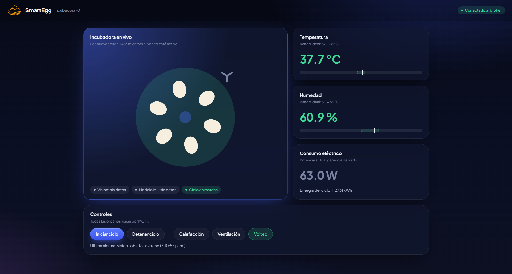
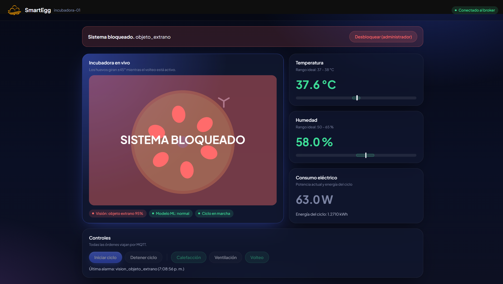
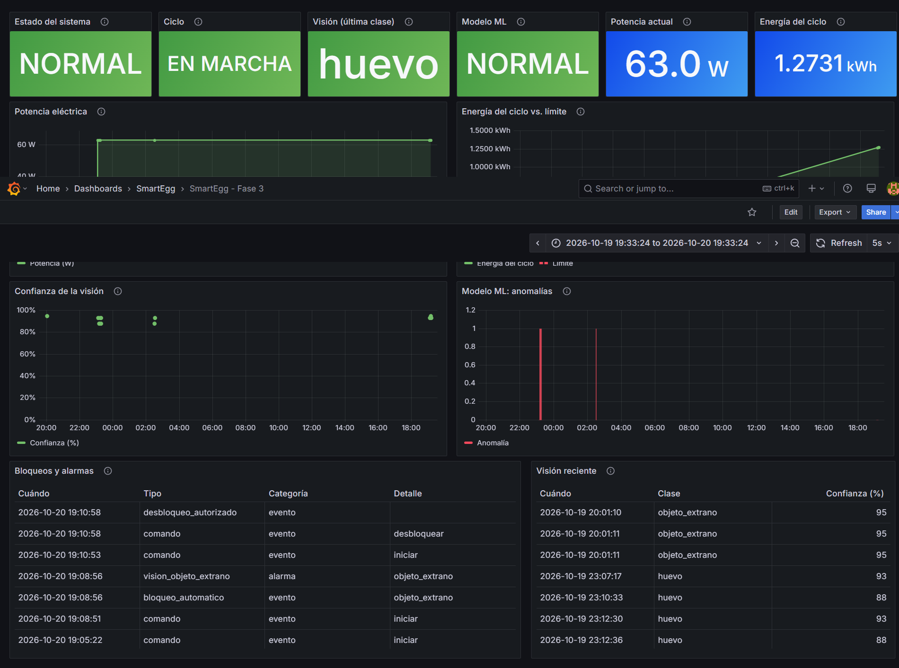
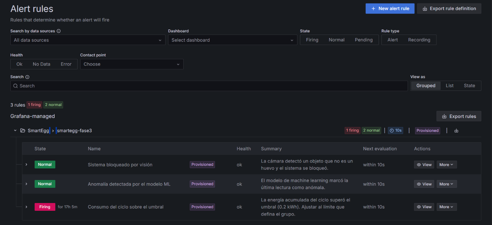

# Manual de usuario: Dashboards de SmartEgg

Este manual explica cómo usar las dos interfaces de monitoreo de SmartEgg: el **dashboard de Grafana** y la **página interactiva (p5.js)**. También explica qué significan los estados y las alertas, y qué hacer cuando algo no se ve.

---

## 1. ¿Qué hay y para qué sirve?

| Interfaz | Para qué se usa | Cómo se conecta |
|---|---|---|
| **Página interactiva (p5.js)** | Ver la incubadora en vivo y dar órdenes (iniciar ciclo, encender actuadores, desbloquear) | Directo al broker MQTT por WebSocket |
| **Grafana** | Ver el historial, las gráficas, las tablas de eventos y las alertas | Consulta los datos guardados en la base de datos |

> **Regla general:** las órdenes se dan desde la página, el análisis se hace en Grafana.

---

## 2. Página interactiva (p5.js)

### 2.1 Cómo abrirla

- En la nube: `http://acye2-frontend.s3-website.us-east-2.amazonaws.com`
- En local: abrir el archivo `web/index.html` en el navegador.

El broker exige usuario y contraseña; se pasan en la dirección:

```
http://acye2-frontend.s3-website.us-east-2.amazonaws.com/?url=ws://18.221.230.97:9001&user=smartegg&pass=<contraseña>&node=incubadora-01
```

**Página completa con el sistema en estado normal:**


### 2.2 Qué muestra

- **Insignia superior derecha:** "Conectado al broker" (verde) o "Sin conexión" (gris). Si dice "Sin conexión", la página no recibe datos ni puede enviar órdenes.
- **Incubadora en vivo (dibujo):**
  - La cámara cambia de color según la temperatura: verde si está en rango, azul si está fría (menos de 37 °C) y roja si está caliente (más de 38 °C).
  - El resplandor naranja indica que la calefacción está encendida.
  - Las aspas del ventilador giran cuando la ventilación está encendida.
  - Los huevos giran ±45° mientras el volteo está activo.
  - Los huevos se ven **rojos** si la cámara detectó un objeto extraño, y **huecos** si la incubadora está vacía.
- **Etiquetas bajo el dibujo:** última clase detectada por la visión (con su porcentaje de confianza), resultado del modelo de machine learning (normal o anomalía) y si el ciclo está en marcha o detenido.
- **Tarjetas de la derecha:** temperatura (rango ideal 37–38 °C), humedad (rango ideal 50–65 %) y consumo eléctrico (potencia actual y energía del ciclo). El número se pone **verde** si está en rango y **rojo** si no. La barra tiene una zona verde con el rango ideal y una marca blanca con el valor actual.
- **Última alarma:** en la parte inferior, la alarma crítica más reciente con su hora.

### 2.3 Botones de control

Todos los botones envían su orden por MQTT. La página **no cambia nada por sí sola**: espera a que el sistema confirme.

| Botón | Qué hace | Cómo se nota que funcionó |
|---|---|---|
| **Iniciar ciclo** | Pide al sistema comenzar el ciclo de incubación | La etiqueta cambia a "Ciclo en marcha" |
| **Detener ciclo** | Pide detener el ciclo | La etiqueta cambia a "Ciclo detenido" |
| **Calefacción** | Enciende o apaga la fuente de calor | El botón se pone verde y aparece el resplandor |
| **Ventilación** | Enciende o apaga el ventilador | El botón se pone verde y las aspas giran |
| **Volteo** | Enciende o apaga el volteo en modo simulación. Con el Arduino real el volteo es automático cada 2 minutos y esta orden no se ejecuta | En simulación, el botón se pone verde y la bandeja se inclina |

Si pulsas un botón y no pasa nada, revisa que la insignia diga "Conectado al broker" y que el dispositivo físico esté encendido.

### 2.4 Pantalla de bloqueo

Si el sistema de visión detecta, en varios fotogramas seguidos, un objeto que **no es un huevo**, el sistema se **bloquea** automáticamente:

- La escena parpadea en rojo con el texto **SISTEMA BLOQUEADO**.
- Aparece un aviso arriba con el motivo.
- **Todos los botones de control se desactivan.**

Para volver a la normalidad, un **administrador** debe pulsar **"Desbloquear (administrador)"**. El sistema solo acepta el desbloqueo de un usuario con rol de administrador; cualquier otra orden de desbloqueo se rechaza.

**Pantalla de bloqueo:**


---

## 3. Dashboard de Grafana

### 3.1 Cómo entrar

- En la nube: `http://18.221.230.97:3000/grafana/`
- En local: `http://localhost:8080/grafana/`
- Usuario `admin` y la contraseña definida al instalar la EC2 (`GRAFANA_ADMIN_PASSWORD` en `infra/.env`).

En el menú izquierdo, entra a **Dashboards → SmartEgg → SmartEgg - Fase 3**.

### 3.2 Rango de tiempo

Arriba a la derecha está el selector de tiempo (por defecto, la última hora). **Las gráficas y tablas muestran solo lo que ocurrió dentro de ese rango.** Si dicen "No data", casi siempre es porque no llegaron datos en ese período; prueba con "Last 24 hours". El dashboard se actualiza solo cada 5 segundos.

### 3.3 Cómo leer cada panel

**Fila superior (estado actual):**

| Panel | Qué significa |
|---|---|
| **Estado del sistema** | NORMAL (verde) o BLOQUEADO (rojo) |
| **Ciclo** | EN MARCHA o DETENIDO |
| **Visión (última clase)** | Lo último que vio la cámara: `huevo` (verde), `objeto_extrano` (rojo) o `vacio` (azul) |
| **Modelo ML** | NORMAL (verde) o ANOMALÍA (rojo), según el último resultado del detector |
| **Potencia actual** | Consumo estimado en este momento, en watts |
| **Energía del ciclo** | Energía acumulada desde que inició el ciclo (se muestra en Wh o kWh) |

**Gráficas:**

| Panel | Cómo leerlo |
|---|---|
| **Potencia eléctrica** | Escalones: sube cuando se enciende un actuador y baja cuando se apaga |
| **Energía del ciclo vs. límite** | La línea verde es la energía acumulada; la línea roja punteada es el límite configurado. Si la verde llega a la roja, se superó el límite |
| **Confianza de la visión** | Cada punto es una clasificación de la cámara. Cuanto más alto, más segura estuvo |
| **Modelo ML: anomalías** | Una barra roja es una lectura marcada como anómala; sin barra, todo normal |

**Tablas:**

- **Bloqueos y alarmas:** bloqueos automáticos, desbloqueos, comandos recibidos y anomalías del modelo, con los más recientes arriba.
- **Visión reciente:** las últimas clasificaciones de la cámara, con su clase y confianza.

**Dashboard completo:**


---

## 4. Alertas

Las alertas se revisan en Grafana, en **Alerting → Alert rules**, dentro de la carpeta SmartEgg. Se evalúan cada 10 segundos.

| Alerta | Se activa cuando | Qué hacer |
|---|---|---|
| **Sistema bloqueado por visión** | El sistema pasa a BLOQUEADO | Revisar qué hay dentro de la incubadora, retirar el objeto y desbloquear desde la página |
| **Anomalía detectada por el modelo ML** | El último resultado del modelo es anómalo | Revisar temperatura, humedad y actuadores; si el valor se normaliza, la alerta se apaga sola |
| **Consumo del ciclo sobre el umbral** | La energía del ciclo supera 0.01 kWh | Revisar qué actuadores están encendidos y por cuánto tiempo |

Una alerta en estado **Firing** (rojo) está activa; en estado **Normal** (verde) todo está dentro de lo esperado.

**Lista de alertas:**


---

## 5. Solución de problemas

| Síntoma | Causa probable | Solución |
|---|---|---|
| La página dice "Sin conexión" | El broker no está disponible, o la dirección o credenciales son incorrectas | Verificar que el broker esté encendido y que la dirección de la página sea la correcta |
| Los números de la página aparecen como "—" | Aún no llegan datos del nodo | Esperar unos segundos y comprobar que el nodo esté publicando |
| Los botones están deshabilitados | No hay conexión o el sistema está bloqueado | Revisar la insignia y el aviso de bloqueo |
| Un botón se pulsa pero el actuador no cambia | El nodo físico no recibió o no ejecutó la orden | Revisar que el nodo esté encendido y conectado |
| Grafana dice "No data" | No hay datos en el rango elegido | Ampliar el rango de tiempo |
| Grafana no abre | El servicio no está corriendo | Verificar que los contenedores estén en ejecución (`docker compose ps`) |

---
