# SmartEgg: modelo de datos de Fase 3

La Fase 3 conserva MongoDB en la base `smartegg`, conforme a la autorización del auxiliar. Este documento complementa el modelo de Fase 2 de [modelo-de-datos.md](modelo-de-datos.md). Las marcas de tiempo se guardan en UTC. No hay claves foráneas rígidas entre telemetría: los eventos se correlacionan por `node_id` y `timestamp`.

## Diagrama lógico

`NODO` es una entidad lógica identificada por `node_id`; no existe como colección propia. Las colecciones de eventos son históricas (append-only). `estado_sistema` y `estado_energia` guardan un único documento vigente por nodo.

```mermaid
erDiagram
    NODO {
        string node_id PK
    }
    NODO ||--o{ LECTURAS : publica
    NODO ||--o{ ACTUADORES_ESTADO : publica
    NODO ||--o{ ML_ANOMALIAS : publica
    NODO ||--o{ VISION_RESULTADOS : publica
    NODO ||--o{ SISTEMA_EVENTOS : genera
    NODO ||--o{ ENERGIA_CONSUMO : genera
    NODO ||--o{ MQTT_EVENTOS : genera
    NODO ||--|| ESTADO_SISTEMA : conserva
    NODO ||--|| ESTADO_ENERGIA : conserva

    ACTUADORES_ESTADO {
        ObjectId _id PK
        string node_id
        datetime timestamp
        object campos_originales
        string topic
        bool retenido
    }
    ML_ANOMALIAS {
        ObjectId _id PK
        string node_id
        datetime timestamp
        object resultado_detector
    }
    VISION_RESULTADOS {
        ObjectId _id PK
        string node_id
        datetime timestamp
        string clase
        float confianza
        object campos_originales
    }
    SISTEMA_EVENTOS {
        ObjectId _id PK
        string node_id
        datetime timestamp
        string tipo
        object motivo
        object detalle
    }
    ENERGIA_CONSUMO {
        ObjectId _id PK
        string node_id
        datetime timestamp
        float potencia_actual_w
        object potencias_w
        object actuadores_encendidos
        float energia_kwh
        float energia_ciclo_kwh
        float limite_ciclo_kwh
        bool alerta_limite_nueva
        object kwh_por_actuador
        object kwh_ciclo_por_actuador
    }
    MQTT_EVENTOS {
        ObjectId _id PK
        string node_id
        datetime timestamp
        string topic
        object campos_originales
    }
    ESTADO_SISTEMA {
        ObjectId _id PK
        string node_id UK
        datetime timestamp
        string estado
        bool bloqueado
        bool ciclo_activo
        object motivo
    }
    ESTADO_ENERGIA {
        ObjectId _id PK
        string node_id UK
        datetime timestamp
        object actuadores_encendidos
        object potencias_w
        float potencia_actual_w
        object kwh_por_actuador
        float energia_kwh
        object kwh_ciclo_por_actuador
        float energia_ciclo_kwh
        datetime inicio_ciclo
        float limite_ciclo_kwh
        bool limite_ciclo_alertado
    }
```



## Colecciones de eventos

| Colección | Datos que conserva |
| :-- | :-- |
| `actuadores_estado` | Estado o comando recibido por MQTT, campos originales, `topic`, `node_id`, `timestamp` y si el mensaje estaba retenido. |
| `ml_anomalias` | Resultado original del detector de anomalías, `node_id` y `timestamp`. |
| `vision_resultados` | Clase y confianza recibidas, además del resto de los campos originales, para revisar la política de bloqueo. |
| `sistema_eventos` | Comandos recibidos, alarmas, bloqueo automático y desbloqueos aceptados o rechazados. `tipo` identifica el evento y `motivo` guarda el detalle del bloqueo. |
| `energia_consumo` | Snapshots publicados al cambiar el estado de actuadores y al iniciar el ciclo. Incluye watts, energía histórica y energía del ciclo. No se suman snapshots entre sí. |
| `mqtt_eventos` | Topics auxiliares, como `status`, y snapshots retenidos de sensores. Los fotogramas JPEG no se almacenan. |

Las colecciones de eventos conservan el payload de origen para tolerar campos adicionales del puente, del servicio de ML y del de visión. El backend añade o normaliza `node_id`, `timestamp`, `topic` y `retenido` según corresponda.

## Colecciones de estado vigente

| Colección | Clave e información |
| :-- | :-- |
| `estado_sistema` | Un documento por `node_id`, con `estado`, `bloqueado`, `ciclo_activo`, `motivo` y última marca de tiempo. Se publica retenido por MQTT para restaurar el estado al reconectar. |
| `estado_energia` | Un documento por `node_id`, con el último estado de actuadores, potencias configuradas, contadores históricos y por ciclo, inicio del ciclo y estado de la alerta. Se actualiza al recibir estados y al iniciar ciclo. |

## Índices

Los índices se declaran en `Backend/src/db/connection.py` y se crean automáticamente al conectar. El script `Backend/tools/inicializar_mongodb_fase3.js` los prepara también para despliegues manuales.

| Colecciones | Índices relevantes |
| :-- | :-- |
| `actuadores_estado`, `ml_anomalias`, `vision_resultados`, `sistema_eventos`, `energia_consumo`, `mqtt_eventos` | `timestamp` descendente y compuesto `(node_id, timestamp descendente)` para consultas históricas por nodo. |
| `estado_sistema`, `estado_energia` | `node_id` único, porque son documentos de estado vigente. |

## Consumo eléctrico y calibración

El consumo estimado de cada actuador se integra desde el instante del estado anterior hasta la siguiente marca de tiempo:

```text
kWh = potencia_W × segundos_encendido / 3 600 000
```

El acumulado histórico continúa entre ciclos. Al recibir `sistema/cmd` con `accion: iniciar`, se cierra primero el intervalo histórico previo y se reinician únicamente los contadores del nuevo ciclo. `ENERGY_LIMIT_KWH_PER_CYCLE` activa una alarma una sola vez al alcanzar el límite del ciclo. Los estados con marcas de tiempo anteriores al último estado persistido se descartan para impedir que el contador retroceda.

Las potencias configuradas son los valores nominales de cada componente: calefacción 60 W (placa del foco), ventilación ≈ 5 W (12 V × 0.42 A) y rotación 3 W (servo a 5 V × 0.6 A, pico con carga). `luz` (3 W) queda configurada, pero el puente no reporta ese estado y no se integra. El límite por ciclo es de 0.01 kWh para la demostración. La justificación está en la sección 11 del [README](../README.md#11-gestión-inteligente-del-consumo-eléctrico).

Ejemplo: si la calefacción (60 W) permanece encendida 10 minutos, aporta `60 × 600 / 3 600 000 = 0.01 kWh`. La estimación supone que el estado anterior permaneció sin cambios hasta el siguiente mensaje MQTT.

## Preparar y consultar la base

Desde `Proyecto_2/Backend`, preparar colecciones e índices con:

```bash
mongosh "mongodb://<host>:27017" tools/inicializar_mongodb_fase3.js
```

Las consultas de verificación están en `Backend/tools/consultas_fase3.mongodb.js`. Allí hay ejemplos para telemetría, actuadores, anomalías, visión, eventos del sistema y energía. La consulta de consumo devuelve el snapshot más reciente, no la suma de snapshots históricos.
