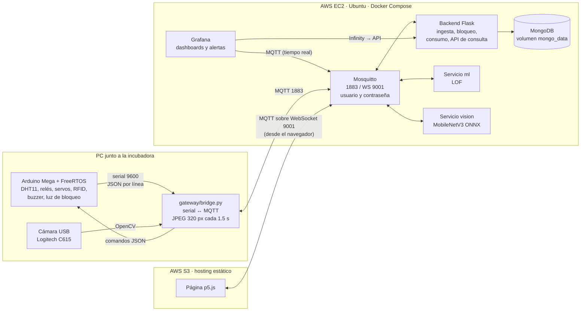
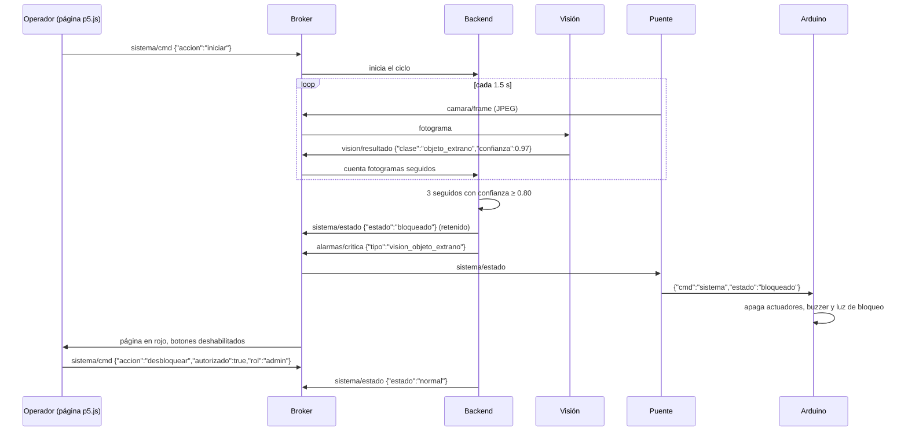
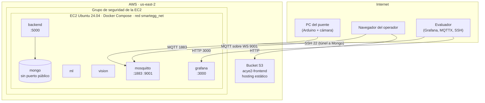
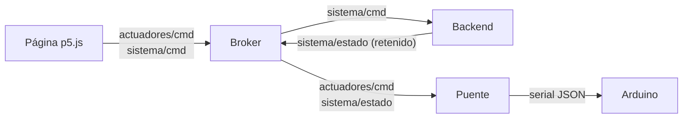
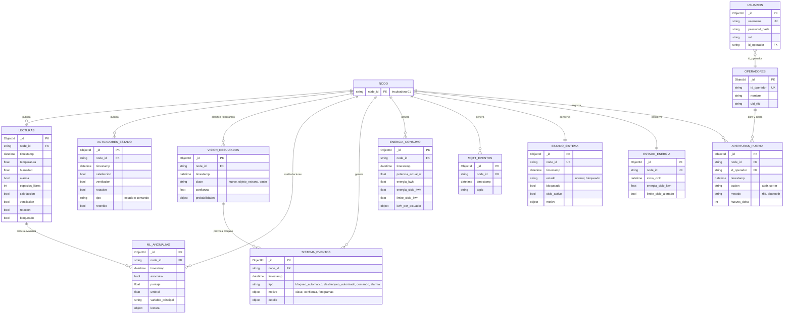

# SmartEgg — Incubadora Inteligente IoT
## Proyecto 2 · Fase 3: Machine Learning, Visión por Computadora y Nube

## Integrantes Grupo #12

| Nombre | Carné |
| :--- | :--- |
| *Juan Manuel Ordóñez Sandoval* | *202400006* |
| *Héctor Alexander Pérez Natareno* | *202406223* |
| *Jhonatan José Acalón Ajanel* | *202401478* |
| *Jennifer Michelle Rosales Juárez* | *202400063* |
| *Diego Fernando Curtidor Sagui* | *202404402* |
| *Emily Maritza Tepeu Guacamaya* | *202402955* |

### Documentos de la entrega

| Entregable | Dónde está |
| :--- | :--- |
| Documento técnico (manual técnico) | Este README |
| Manual de usuario | [`Docs/manual-usuario-fase3.md`](Docs/manual-usuario-fase3.md) y [`Docs/manual-usuario-dashboards.md`](Docs/manual-usuario-dashboards.md) |
| Notebook de ML | [`ml/anomalias.ipynb`](ml/anomalias.ipynb) (detalle en [`ml/README.md`](ml/README.md)) |
| Módulo de visión | [`vision/`](vision/) (detalle en [`vision/README.md`](vision/README.md)) |
| Bitácora de desarrollo | [`Docs/bitacora-desarrollo.md`](Docs/bitacora-desarrollo.md) |
| Video de presentación | [ver video](https://drive.google.com/drive/folders/1gzGRtm7lNQ4PqCDpetA7z_xauj2VuVlg) |
| Infraestructura en la nube | [`infra/`](infra/) y [`infra/nube/LEEME.md`](infra/nube/LEEME.md) |
| Dashboards de Grafana exportados | [`Grafana/provisioning/dashboards/`](Grafana/provisioning/dashboards/) |
| Documento técnico de la Fase 2 (base heredada) | [`Docs/documento-tecnico-fase2.md`](Docs/documento-tecnico-fase2.md) |

---

## Índice

1. [Objetivos de la Fase 3](#1-objetivos-de-la-fase-3)
2. [Descripción de la solución](#2-descripción-de-la-solución)
3. [Capas del framework IoT](#3-capas-del-framework-iot)
4. [Arquitectura extendida](#4-arquitectura-extendida)
5. [Capa física: continuidad con la Fase 2](#5-capa-física-continuidad-con-la-fase-2)
6. [Pipeline de Machine Learning: detección de anomalías](#6-pipeline-de-machine-learning-detección-de-anomalías)
7. [Módulo de visión por computadora](#7-módulo-de-visión-por-computadora)
8. [Bloqueo inteligente (valor disruptivo)](#8-bloqueo-inteligente-valor-disruptivo)
9. [Infraestructura en la nube (AWS)](#9-infraestructura-en-la-nube-aws)
10. [Comunicación MQTT](#10-comunicación-mqtt)
11. [Gestión inteligente del consumo eléctrico](#11-gestión-inteligente-del-consumo-eléctrico)
12. [Stack de monitoreo: Grafana y p5.js](#12-stack-de-monitoreo-grafana-y-p5js)
13. [Base de datos](#13-base-de-datos)
14. [Documentación de la API](#14-documentación-de-la-api)
15. [Evidencias](#15-evidencias)
16. [Estructura del repositorio y ejecución](#16-estructura-del-repositorio-y-ejecución)

---

## 1. Objetivos de la Fase 3

**General.** Ampliar la incubadora SmartEgg de la Fase 2 con tres capas de inteligencia: un modelo de machine learning que detecta anomalías en los datos de los sensores, visión por computadora que verifica que dentro de la incubadora solo haya huevos, y el despliegue de todo el stack en la nube con dashboards y alertas.

**Específicos.**

| Objetivo | Cómo se verifica | Resultado |
| :--- | :--- | :--- |
| Entrenar un detector de anomalías con el histórico de la Fase 2 | Al menos dos métricas en un conjunto de prueba | LOF con F1 = 0.913, AUC-ROC = 0.980 y matriz de confusión ([sección 6](#6-pipeline-de-machine-learning-detección-de-anomalías)) |
| Clasificar cada fotograma en huevo, objeto extraño o vacío | Exactitud en prueba y clasificación en vivo | MobileNetV3-small con exactitud de 97.2 % en prueba ([sección 7](#7-módulo-de-visión-por-computadora)) |
| Bloquear el sistema ante un objeto que no es huevo | Alarma física, actuadores apagados y página bloqueada | Política de 3 fotogramas seguidos, buzzer y luz en el Arduino ([sección 8](#8-bloqueo-inteligente-valor-disruptivo)) |
| Migrar el stack Docker a la nube | Broker, base de datos, backend, ML, visión y Grafana en una EC2 | EC2 Ubuntu con Docker Compose y página en un bucket S3 ([sección 9](#9-infraestructura-en-la-nube-aws)) |
| Monitorear el consumo eléctrico | Potencia en tiempo real, límite por ciclo y alertas | Integración en kWh por actuador ([sección 11](#11-gestión-inteligente-del-consumo-eléctrico)) |
| Dashboards con alertas | Grafana en tiempo real con al menos una alerta activa | 3 dashboards y 3 reglas de alerta ([sección 12](#12-stack-de-monitoreo-grafana-y-p5js)) |

---

## 2. Descripción de la solución

En la Fase 2 la incubadora controlaba temperatura y humedad por umbrales, volteaba los huevos, contaba los espacios ocupados y registraba los accesos con RFID. Solo reaccionaba cuando un valor ya estaba fuera de rango, no veía lo que había dentro y toda la plataforma corría en una computadora local.

La Fase 3 conserva ese nodo físico y su lógica de umbrales sin cambios, y agrega:

- **Detección de anomalías con ML.** Un modelo Local Outlier Factor entrenado con 27 537 lecturas reales de la Fase 2 evalúa cada lectura que llega por MQTT. Detecta combinaciones que un umbral fijo no ve: por ejemplo, 30 °C es normal mientras el foco calienta y es una falla si el foco está apagado. Cuando detecta una anomalía publica una alerta en el broker.
- **Visión por computadora.** Una cámara USB apunta a la bandeja. Cada fotograma se recorta a la región de interés con OpenCV y lo clasifica una red MobileNetV3-small entrenada por el grupo con fotos propias: huevo, objeto extraño o vacío.
- **Bloqueo inteligente.** Si hay un ciclo en marcha y la cámara ve un objeto extraño en 3 fotogramas seguidos, el sistema se bloquea: el Arduino apaga los actuadores y enciende el buzzer y la luz de bloqueo, y la página web queda bloqueada. Solo un administrador puede desbloquearlo.
- **Nube.** Broker Mosquitto con autenticación, MongoDB, backend, servicios de ML y visión y Grafana corren en una instancia EC2 con Docker Compose. La página interactiva p5.js está alojada en un bucket S3 y se conecta al broker por WebSocket.
- **Consumo eléctrico.** El backend integra la potencia de cada actuador en el tiempo, publica la potencia actual y la energía del ciclo, y genera una alerta cuando el ciclo supera el límite configurado.

El control de sensores y actuadores viaja **solo por MQTT**. La API REST que queda es de consulta (historial, reportes, lotes) y la usa Grafana para leer la base de datos; ninguna ruta REST enciende, apaga ni bloquea nada.

---

## 3. Capas del framework IoT

| Capa | Componentes de la Fase 3 |
| :--- | :--- |
| **Percepción** | Sensor DHT11 (temperatura y humedad), 6 finales de carrera (espacios de la bandeja), lector RFID MFRC-522, cámara USB Logitech C615 |
| **Actuación** | Relé del foco (calefacción), relé del ventilador, servo de volteo, servo de la cerradura, buzzer (pin 6) y luz de bloqueo (pin 5) |
| **Red / transporte** | Serial USB 9600 baudios (Arduino ↔ puente), MQTT sobre TCP 1883 y MQTT sobre WebSocket 9001 hacia la EC2, Bluetooth clásico HC-05 para la app móvil |
| **Procesamiento (edge)** | Arduino Mega 2560 con FreeRTOS: control por umbrales, volteo, puerta, bloqueo. El puente (`gateway/bridge.py`) traduce serial ↔ MQTT y comprime los fotogramas a JPEG de 320 px |
| **Procesamiento (nube)** | Servicio `ml` (LOF), servicio `vision` (ONNX), backend Flask (ingesta, política de bloqueo, consumo) |
| **Almacenamiento** | MongoDB 7 con volumen persistente en la EC2 |
| **Aplicación / presentación** | Grafana (tiempo real, histórico y alertas), página p5.js en S3, frontend React de la Fase 2 y app Flutter |

---

## 4. Arquitectura extendida



**Flujo de datos.**

1. El Arduino imprime cada segundo una línea JSON con la telemetría y el estado de los actuadores. El puente la valida, le agrega la marca de tiempo y la publica en `sensores/lectura`; si cambió algún actuador, también publica `actuadores/estado` (retenido).
2. El puente captura un fotograma cada 1.5 s, lo reduce a 320 px de ancho, lo comprime a JPEG calidad 70 y lo publica en `camara/frame`.
3. El servicio `vision` clasifica cada fotograma y publica `vision/resultado`. El servicio `ml` evalúa cada lectura y publica `ml/anomalia`.
4. El backend guarda todo en MongoDB, aplica la política de bloqueo, calcula el consumo y publica `sistema/estado`, `energia/consumo` y `alarmas/critica`.
5. El puente está suscrito a `sistema/estado` y `actuadores/cmd` y los traduce a comandos seriales que el firmware procesa en `IoT/main/comandos.cpp`.
6. Grafana lee el broker para los paneles en vivo y la API del backend para los históricos y las alertas. La página p5.js se suscribe a `smartegg/incubadora-01/#` desde el navegador y publica los comandos del operador.

**Por qué el backend no lee el serial.** En la Fase 2 el backend leía el puerto USB. En la nube eso es imposible, porque el Arduino está conectado a la PC y no a la EC2. Por eso la lectura serial del backend está desactivada (`SERIAL_ENABLED=false`) y el puente corre en la PC y publica directamente al broker en la nube. Así el nodo físico publica y recibe por el broker de la nube, no por uno local.

---

## 5. Capa física: continuidad con la Fase 2

La incubadora es la misma de la Fase 2 (fotos, pines y tareas FreeRTOS en el [documento técnico de la Fase 2](Docs/documento-tecnico-fase2.md)).

**La lógica de control por umbrales no cambió.** `IoT/main/logica_umbrales.cpp` es idéntico al de la Fase 2: foco encendido por debajo de 37 °C, ventilador por encima de 38 °C, alarma fuera de 50–65 % de humedad. Los umbrales del firmware coinciden con `TEMP_MIN`, `TEMP_MAX`, `HUM_MIN` y `HUM_MAX` del `.env`.

Cambios en el firmware para la Fase 3 (`actuators.cpp`, `comandos.cpp`, `estado_compartido.cpp`, `main.ino`):

| Cambio | Detalle |
| :--- | :--- |
| Lectura de comandos por serial | `comandos.cpp` lee líneas JSON con ArduinoJson: `{"cmd":"sistema","estado":"bloqueado"|"normal"}` y `{"cmd":"actuador","nombre":"calefaccion"|"ventilador","accion":"on"|"off"}` |
| Estado de bloqueo | Con `bloqueado = true` se apagan calefacción, ventilador y servo, suena el buzzer y se enciende la luz de bloqueo. Mientras dura el bloqueo se ignoran los comandos de actuadores |
| Comando manual de actuadores | Un comando de la página fuerza el relé durante 30 s; después el control vuelve a los umbrales. No modifica los umbrales ni la lógica de `logica_umbrales.cpp` |
| Telemetría ampliada | La línea serial agrega `rotacion`, `bloqueado`, `calefaccion` y `ventilador` |
| Buzzer con `tone()` | El buzzer suena a 2 kHz con `tone()`, así funciona tanto si es activo como si es pasivo |

**Actuadores por categoría** (rúbrica: al menos 3):

| Categoría | Actuador | Pin |
| :--- | :--- | :--- |
| Calefacción | Foco incandescente por relé (activo en bajo) | 7 |
| Ventilación | Ventilador DC por relé (activo en bajo) | 8 |
| Volteo | Servo de la bandeja, ±45° cada 2 min | 9 |
| Señalización | Buzzer (alarma de umbral y de bloqueo) | 6 |
| Señalización | Luz de bloqueo | 5 |
| Acceso | Servo de la cerradura (RFID / Bluetooth) | 10 |

**Cámara.** Webcam USB Logitech C615 fija sobre la bandeja, apuntando al interior. Está conectada a la PC del puente; en `infra/.env` se usa la ruta estable `/dev/v4l/by-id/usb-046d_HD_Webcam_C615_...` porque los índices `/dev/videoN` cambian entre arranques.

---

## 6. Pipeline de Machine Learning: detección de anomalías

Código: `ml/pipeline.py` (compartido por el notebook y el servicio), `ml/anomalias.ipynb` (notebook ejecutado), `ml/service.py` (servicio MQTT). Detalle completo en [`ml/README.md`](ml/README.md).

### 6.1. Extracción y exploración

- **Fuente:** colección `lecturas` de MongoDB de la Fase 2, exportada a `ml/data/lecturas_fase2.csv`: 27 537 lecturas entre el 2 de septiembre y el 2 de octubre de 2026, a 1 lectura por segundo.
- **Calidad:** sin nulos ni duplicados; hay huecos entre sesiones de prueba.
- **Hallazgo principal:** hay dos regímenes normales. Uno de **incubación** (36.5–38.5 °C) y otro de **precalentamiento** (20–35 °C con el foco encendido y la temperatura subiendo). Un umbral fijo no distingue un precalentamiento normal de un foco quemado.
- **Anomalías reales:** las lecturas con `alarma = 1` del firmware y las lecturas imposibles del DHT11 (< 5 °C o < 5 % de humedad).

### 6.2. Preprocesamiento y estrategia

- **Features:** `temperatura`, `humedad`, `calefaccion`, `ventilacion`, `rotacion`, `d_temp` y `d_hum` (derivadas por segundo; se reinician si pasan más de 10 s entre lecturas).
- **Escalado:** `StandardScaler`. LOF mide distancias y sin escalar la humedad dominaría sobre los actuadores.
- **Estrategia no supervisada.** El modelo se entrena solo con lecturas normales (70 % del histórico, 18 171 lecturas). Así no hace falta etiquetar a mano, y el modelo aprende cómo se ve el funcionamiento normal en vez de memorizar un tipo de falla.
- **Validación y prueba** (15 % cada una): lecturas normales mezcladas con las anomalías reales y con anomalías **simuladas** sobre lecturas reales: sobrecalentamiento (foco pegado), enfriamiento (foco quemado), humedad baja o alta, saltos bruscos y actuadores incoherentes.

### 6.3. Entrenamiento y evaluación

Conjunto de prueba: 5 083 lecturas, 1 189 anómalas.

| Modelo | Precisión | Recall | **F1** | AUC-ROC |
| :--- | :--- | :--- | :--- | :--- |
| Isolation Forest | 0.581 | 0.783 | 0.667 | 0.874 |
| **Local Outlier Factor (n_neighbors=35)** | **0.849** | **0.987** | **0.913** | **0.980** |

Matriz de confusión del LOF (filas = real, columnas = predicho):

| | normal | anomalía |
| :--- | :--- | :--- |
| **normal** | 3 686 | 208 |
| **anomalía** | 16 | 1 173 |


**Por qué LOF.** Isolation Forest corta el espacio con planos paralelos a los ejes y falla justo en las fallas que combinan variables (temperatura baja con el foco apagado). LOF compara cada lectura con la densidad de sus vecinos en el espacio conjunto: detecta el 99.5 % de las anomalías reales y el 100 % de los sobrecalentamientos, enfriamientos y actuadores incoherentes.

**Umbral de detección.** Puntaje LOF ≥ **1.63**, el que maximiza el F1 en validación ([distribución del puntaje](ml/evidencias/distribucion_puntaje.png)). Para no alertar por una sola lectura ruidosa, el servicio exige **3 lecturas atípicas seguidas** (`ML_CONSECUTIVAS`). El umbral se cambia con `ML_UMBRAL` sin reentrenar.

### 6.4. Guardado e integración

El modelo y el escalador se guardan en `ml/modelo/modelo_lof.joblib`; el umbral y las métricas en `ml/modelo/meta.json`. El servicio `ml` del compose los carga al arrancar, se suscribe a `sensores/lectura` y `actuadores/estado` (ignora los retenidos) y publica `ml/anomalia` cuando cambia el estado o cada 5 s. El backend guarda cada resultado en `ml_anomalias` y, si es anómalo, publica `alarmas/critica` con `tipo: "anomalia_ml"`. Grafana dispara la alerta "Anomalía detectada por el modelo ML" y la página muestra "Modelo ML: anomalía".

Para la demostración, `ml/simular_anomalia.py --falla sobrecalentamiento` publica lecturas normales y luego una falla; a la tercera lectura atípica se publica la alerta ([log de la prueba](ml/evidencias/alerta_simulada.log)).

---

## 7. Módulo de visión por computadora

Código en [`vision/`](vision/): `common.py` (preprocesamiento OpenCV compartido), `capture_dataset.py` (captura), `train.py` (entrenamiento y evaluación), `service.py` (servicio MQTT), `probar_camara.py` y `ver_camara.py` (pruebas locales).

### 7.1. Condiciones visuales detectadas

| Clase en disco | Clase en MQTT | Qué significa | Efecto |
| :--- | :--- | :--- | :--- |
| `huevo` | `huevo` | Uno o más huevos en la bandeja | Ninguno |
| `objeto` | `objeto_extrano` | Cualquier cosa que no es huevo, sola o junto a huevos | Cuenta para el bloqueo |
| `vacio` | `vacio` | Bandeja sin nada | Ninguno |

### 7.2. Dataset propio

Todas las fotos son reales, tomadas el 22 de octubre de 2026 con la misma cámara instalada en la incubadora (`capture_dataset.py`). Están en `vision/dataset/{clase}/{clase}_{sesion}_{n}.jpg`.

| Clase | s01 | s02 | s03 | s04 | s05 | Total |
| :--- | ---: | ---: | ---: | ---: | ---: | ---: |
| huevo | 262 | 63 | 65 | 32 | 59 | **481** |
| objeto | 212 | 107 | 100 | 104 | 116 | **639** |
| vacio | 196 | 155 | 40 | 41 | 40 | **472** |
| **Total** | | | | | | **1 592** |

**Iluminación.** Cada sesión se tomó con una luz distinta. El brillo medio de los fotogramas (escala 0–255) lo confirma:

| Sesión | Condición | Brillo medio (huevo / objeto / vacío) |
| :--- | :--- | :--- |
| s01 | Luz blanca intensa | 132 / 143 / 157 |
| s02 | Penumbra con luz cálida | 48 / 42 / 37 |
| s03 | Luz blanca intensa, otra posición de los objetos | 121 / 117 / 158 |
| s04 | Penumbra con luz cálida | 70 / 71 / 54 |
| s05 | Luz mixta | 117 / 122 / 35 |

Los objetos extraños incluyen encendedores, una linterna, una tarjeta, un clip, un lápiz, unas pinzas y un rollo de cinta, solos y junto a huevos (una escena con un huevo y un objeto se etiqueta como `objeto`, porque igual debe bloquear).


### 7.3. Captura y preprocesamiento con OpenCV

El preprocesamiento es el mismo en la captura, el entrenamiento y producción (`vision/common.py`):

1. `cv2.imdecode` del JPEG que llega por MQTT (320 px de ancho, calidad 70, igual que el puente).
2. Recorte de la **región de interés** (ROI) con fracciones `x, y, w, h` del fotograma. La ROI actual es `0.142, 0.052, 0.819, 0.942` (`vision/models/config.json`) y cubre la bandeja. Si la cámara se mueve se recalibra con `./plataforma.sh roi`, sin reentrenar.
3. `cv2.resize` a 224 × 224 con `INTER_AREA` y conversión BGR → RGB.
4. Normalización a 0–1 con la media y desviación de ImageNet, y transposición a NCHW.

### 7.4. Modelo y entrenamiento

- **Arquitectura:** MobileNetV3-small preentrenada en ImageNet (*transfer learning*), con la última capa reemplazada por 3 salidas. Se eligió porque pesa poco y la inferencia en la CPU de la EC2 tarda decenas de milisegundos.
- **Entrenamiento** (`train.py --roi ... --epochs 15`): 3 épocas con el extractor congelado (Adam, lr = 1e-3) y luego ajuste fino de toda la red (lr = 1e-4). Aumento de datos: variación de brillo, contraste y saturación, rotación de ±10° y volteo horizontal.
- **División por sesión.** Train, validación y prueba se separan por sesión, no por foto. Fotos consecutivas de una misma sesión son casi idénticas; si se mezclaran, la prueba mediría memoria y no generalización.
- **Exportación:** ONNX (`vision/models/modelo.onnx`). El servicio usa `onnxruntime`, sin PyTorch, y la imagen Docker queda liviana.

### 7.5. Resultados

Conjunto de prueba (177 fotos de sesiones que el modelo no vio): **exactitud 97.2 %**.

| Clase | Precisión | Recall | F1 | Soporte |
| :--- | ---: | ---: | ---: | ---: |
| huevo | 0.941 | 1.000 | 0.970 | 32 |
| objeto | 1.000 | 0.952 | 0.975 | 104 |
| vacio | 0.932 | 1.000 | 0.965 | 41 |

Matriz de confusión (filas = real, columnas = predicho):

| | huevo | objeto | vacio |
| :--- | ---: | ---: | ---: |
| **huevo** | 32 | 0 | 0 |
| **objeto** | 2 | 99 | 3 |
| **vacio** | 0 | 0 | 41 |


**Umbral.** `train.py` evalúa la confianza mínima para marcar un objeto extraño. Ningún umbral entre 0.50 y 0.95 produjo falsos bloqueos (huevo o vacío clasificado como objeto); el recall de objeto baja de 0.952 a 0.846. El servicio publica la clase con su confianza (umbral de `objeto_detectado`: 0.5) y el backend solo cuenta para el bloqueo los fotogramas de `objeto_extrano` con confianza ≥ **0.80** (`VISION_CONFIDENCE_THRESHOLD`).

### 7.6. Ejemplos de imágenes procesadas

El servicio guarda cada 15 s por clase el fotograma original y la ROI que vio el modelo (`vision/evidencias/`). Nombre: `fecha_hora_clase_confianza_{frame|roi}.jpg`.

| Clase | Fotograma completo | ROI procesada |
| :--- | :--- | :--- |
| huevo (1.00) |  |  |
| objeto (1.00) |  |  |
| vacío (1.00) |  |  |

---

## 8. Bloqueo inteligente (valor disruptivo)

### 8.1. Qué hace



1. El operador inicia el ciclo desde la página (`sistema/cmd`, `accion: iniciar`).
2. Con el ciclo activo, el backend cuenta los resultados `objeto_extrano` con confianza ≥ 0.80. Cualquier otro resultado reinicia el contador.
3. Al tercer fotograma seguido (`VISION_CONSECUTIVE_FRAMES`, unos 4.5 s) el backend guarda el evento en `sistema_eventos` (`tipo: "bloqueo_automatico"`, con fecha, hora, clase, confianza y fotogramas), actualiza `estado_sistema`, publica `sistema/estado` retenido y emite `alarmas/critica`.
4. El puente traduce el estado al Arduino: se apagan foco, ventilador y servo, suena el buzzer y se enciende la luz de bloqueo. Como el mensaje es retenido, si el Arduino o la página se reconectan vuelven a quedar bloqueados.
5. La página muestra "SISTEMA BLOQUEADO" y deshabilita todos los controles. Grafana pasa el panel "Estado del sistema" a BLOQUEADO y dispara la alerta "Sistema bloqueado por visión".
6. Solo un comando `desbloquear` con `autorizado: true` y un rol de `SYSTEM_UNLOCK_ROLES` (`admin`, `administrador`) desbloquea. Los intentos rechazados quedan registrados como `desbloqueo_rechazado`.

Los mensajes retenidos de visión, ML y comandos se guardan, pero no disparan acciones al reconectar. Así un resultado viejo no bloquea el sistema ni reinicia un ciclo.

### 8.2. Justificación

En una incubadora artesanal es común que entren objetos que no son huevos: herramientas olvidadas, piezas sueltas o un huevo roto con la cáscara aparte. Un objeto encima de la bandeja puede romper huevos durante el volteo, tapar el flujo de aire o quedar expuesto a la fuente de calor. Los sensores de la Fase 2 no lo notan, porque el DHT11 y los finales de carrera no distinguen un huevo de otro objeto que pese lo mismo.

El valor está en que el sistema no se limita a avisar: detiene el proceso físico. Apaga calor, ventilación y volteo, avisa en el sitio con sonido y luz, y bloquea la interfaz remota para que nadie reanude el ciclo sin revisar. El desbloqueo queda en manos de un administrador y cada bloqueo queda registrado con fecha, hora y clase detectada, lo que deja trazabilidad de qué pasó en cada ciclo. Todo esto usa una webcam común y un modelo entrenado con fotos propias, sin hardware especializado.

### 8.3. Video de presentación

**Video de presentación (≥ 5 min):** [ver video](https://drive.google.com/drive/folders/1gzGRtm7lNQ4PqCDpetA7z_xauj2VuVlg)

El video recorre la arquitectura, el modelo de ML, la visión IA, la nube, los dashboards y el bloqueo inteligente en vivo.

---

## 9. Infraestructura en la nube (AWS)

### 9.1. Diagrama



### 9.2. Recursos

| Recurso | Configuración | Acceso |
| :--- | :--- | :--- |
| EC2 | Ubuntu 24.04 x86_64, `t3.small` o mayor, 20 GB, 2 GB de swap (para compilar las imágenes) | IP pública `18.221.230.97` |
| Docker Compose | `infra/docker-compose.yml`: `mosquitto`, `mongo`, `backend`, `ml`, `vision`, `grafana` (y `frontend`/`caddy` de la Fase 2) | `sudo docker compose ps` en `~/AYC2_G12/Proyecto_2/infra` |
| Bucket S3 | Hosting estático con lectura pública solo de objetos, sin escritura pública | `http://acye2-frontend.s3-website.us-east-2.amazonaws.com` |
| Grafana | Sirve bajo `/grafana/`; se entra con el usuario `admin` y la contraseña definida al instalar la EC2 | `http://18.221.230.97:3000/grafana/` |
| Broker | Mosquitto 2.0 con `allow_anonymous false`; el archivo `passwd` se genera al arrancar desde `MQTT_USER`/`MQTT_PASS` | `18.221.230.97:1883` y `ws://18.221.230.97:9001` |

La instalación se automatizó en `infra/nube/instalar_vm.sh` (Docker, swap, clonado, `.env` con claves aleatorias y `docker compose up -d --build`), la página se publica con `infra/nube/subir_web_s3.sh` y las reglas del grupo de seguridad se crean con `infra/nube/crear_puertos_aws.sh`. Pasos completos en [`infra/nube/LEEME.md`](infra/nube/LEEME.md).

### 9.3. Grupo de seguridad

| Puerto | Origen | Servicio | Por qué está abierto |
| :--- | :--- | :--- | :--- |
| 22 | IP de la PC de administración (/32) | SSH | Administración y túnel a MongoDB para la revisión de la base |
| 1883 | 0.0.0.0/0 | Mosquitto | El puente de la PC publica y recibe por aquí |
| 9001 | 0.0.0.0/0 | Mosquitto (WebSocket) | La página del bucket corre en el navegador y solo puede usar WebSocket |
| 3000 | 0.0.0.0/0 | Grafana | Dashboards en la nube |
| 5000 | 0.0.0.0/0 | Backend | API de consulta y documentación Swagger (`/api/docs`). No controla actuadores |

No se abren 27017 (MongoDB), 5173 (frontend React) ni 8080 (proxy Caddy). MongoDB solo es accesible dentro de la red de Docker o por túnel SSH. 1883 y 9001 están abiertos a cualquier IP para que la calificación funcione desde cualquier red, pero el broker exige usuario y contraseña.

### 9.4. Base de datos: opción elegida y justificación

Se eligió la **opción a: MongoDB en un contenedor Docker en la misma EC2, con volumen persistente** (`mongo_data`), con la autorización del auxiliar para usar un motor documental en lugar de uno relacional.

- **Continuidad.** El histórico de la Fase 2 (27 537 lecturas con las que se entrenó el ML) ya estaba en MongoDB; no hizo falta migrar esquemas ni datos.
- **Payloads JSON.** Todo llega por MQTT en JSON con campos que varían entre módulos (visión trae probabilidades por clase, ML trae la lectura evaluada). Se guardan tal como llegan y el backend solo normaliza `node_id` y `timestamp`.
- **Costo y latencia.** Un contenedor en la misma VM no tiene costo extra frente a RDS y el backend lo consulta por la red interna de Docker.
- **Persistencia.** Los volúmenes `mongo_data`, `grafana_data` y `mosquitto_data` sobreviven a `docker compose restart`, `stop` y `down` (solo `down -v` los borra).

Comprobación de persistencia (en la EC2, desde `infra/`):

```bash
sudo docker compose exec -T mongo mongosh smartegg --quiet --eval 'db.lecturas.countDocuments()'
sudo docker compose restart
sudo docker compose exec -T mongo mongosh smartegg --quiet --eval 'db.lecturas.countDocuments()'   # mismo número o mayor
```

---

## 10. Comunicación MQTT

### 10.1. Control exclusivo por MQTT

Los únicos caminos que cambian el estado físico son los topics `sistema/cmd`, `sistema/estado` y `actuadores/cmd`. La página los publica, el backend aplica la política y el puente se los entrega al Arduino. La API REST no tiene rutas para encender actuadores, iniciar ciclos ni bloquear.



### 10.2. Topics

Todos los topics cuelgan de `smartegg/{node_id}/`; el nodo por defecto es `incubadora-01`. Los payloads son JSON UTF-8, salvo `camara/frame` (JPEG binario).

| Topic | Publicador | Suscriptor(es) | QoS | Retenido | Contenido |
| :--- | :--- | :--- | :---: | :---: | :--- |
| `sensores/lectura` | Puente | Backend, ml, Grafana, página | 1 | No | Telemetría completa cada segundo |
| `actuadores/estado` | Puente | Backend, ml, Grafana, página | 1 | Sí | Estado de calefacción, ventilación y rotación al cambiar (o cada 10 s) |
| `puerta/evento` | Puente | Backend, Grafana | 1 | No | Apertura/cierre con RFID o Bluetooth |
| `status` | Puente (y LWT) | Backend, Grafana | 1 | Sí | `online` / `offline` del nodo |
| `camara/frame` | Puente | vision | 0 | No | JPEG de 320 px cada 1.5 s (no se guarda en la base) |
| `vision/resultado` | vision | Backend, página | 0 | No | Clase, confianza y probabilidades (Grafana la lee de la base por la API) |
| `ml/anomalia` | ml | Backend, página | 1 | No | Resultado del detector de anomalías (Grafana lo lee por la API) |
| `sistema/cmd` | Página | Backend | 1 | No | Iniciar, detener o desbloquear |
| `sistema/estado` | Backend | Puente, página | 1 | Sí | Estado normal/bloqueado y ciclo |
| `actuadores/cmd` | Página | Puente, Backend (registro) | 1 | No | Encender o apagar un actuador |
| `energia/consumo` | Backend | Página | 1 | Sí | Potencia actual y energía acumulada |
| `alarmas/critica` | Backend | Página, frontend React | 1 | Sí | Alarmas de umbral, ML, visión y consumo |

### 10.3. Payloads

`sensores/lectura` (puente, a partir de la línea serial del Arduino):
```json
{"temperatura": 37.4, "humedad": 56.0, "sistema_encendido": true, "alarma": false,
 "espacios_libres": 4, "puerta_abierta": false, "rotacion": false, "bloqueado": false,
 "calefaccion": true, "ventilacion": false, "id_operador_actual": null,
 "timestamp": "2026-10-23T21:30:00.512000+00:00"}
```

`actuadores/estado` (puente, retenido):
```json
{"calefaccion": true, "ventilacion": false, "rotacion": false, "timestamp": "2026-10-23T21:30:00.512000+00:00"}
```

`status` (puente; el LWT publica `offline` si la conexión se cae):
```json
{"estado": "online"}
```

`camara/frame`: bytes JPEG crudos, sin JSON.

`vision/resultado` (vision):
```json
{"clase": "objeto_extrano", "confianza": 0.97,
 "probabilidades": {"huevo": 0.02, "objeto_extrano": 0.97, "vacio": 0.01},
 "umbral": 0.5, "objeto_detectado": true, "latencia_ms": 18.4, "ts": "2026-10-23T21:30:01+00:00"}
```

`ml/anomalia` (ml):
```json
{"anomalia": true, "puntaje": 6.4622, "umbral": 1.6314, "lecturas_atipicas_seguidas": 3,
 "variable_principal": "temperatura", "desviacion_z": 1.11, "modelo": "LOF",
 "lectura": {"temperatura": 38.54, "humedad": 57.0, "calefaccion": 1.0, "ventilacion": 0.0,
             "rotacion": 0.0, "d_temp": 0.35, "d_hum": 0.0},
 "timestamp": "2026-10-23T21:30:02+00:00"}
```

`sistema/cmd` (página):
```json
{"accion": "iniciar"}
{"accion": "detener"}
{"accion": "desbloquear", "autorizado": true, "rol": "admin"}
```

`sistema/estado` (backend, retenido):
```json
{"node_id": "incubadora-01", "estado": "bloqueado", "bloqueado": true, "ciclo_activo": true,
 "motivo": {"tipo": "objeto_extrano", "clase": "objeto_extrano", "confianza": 0.97, "fotogramas_consecutivos": 3},
 "timestamp": "2026-10-23T21:30:05+00:00"}
```

`actuadores/cmd` (página). El puente lo traduce a `{"cmd":"actuador","nombre":"ventilador","accion":"on"}`; el firmware acepta calefacción y ventilación:
```json
{"actuador": "ventilacion", "accion": "on"}
```

`energia/consumo` (backend, retenido):
```json
{"node_id": "incubadora-01", "potencia_actual_w": 63.0,
 "potencias_w": {"calefaccion": 60.0, "ventilacion": 5.0, "rotacion": 3.0, "luz": 3.0},
 "actuadores_encendidos": {"calefaccion": true, "ventilacion": false, "rotacion": true},
 "energia_kwh": 0.0920, "energia_ciclo_kwh": 0.0248, "limite_ciclo_kwh": 0.01,
 "kwh_por_actuador": {"calefaccion": 0.0905, "ventilacion": 0.0011, "rotacion": 0.0004},
 "alerta_limite_nueva": false, "timestamp": "2026-10-23T21:30:06+00:00"}
```

`alarmas/critica` (backend). `tipo` puede ser `umbral_sensor`, `anomalia_ml`, `vision_objeto_extrano` o `consumo_electrico`:
```json
{"tipo": "vision_objeto_extrano", "activa": true,
 "detalle": {"tipo": "objeto_extrano", "clase": "objeto_extrano", "confianza": 0.97, "fotogramas_consecutivos": 3},
 "node_id": "incubadora-01", "timestamp": "2026-10-23T21:30:05+00:00"}
```

### 10.4. Seguridad del broker

- `allow_anonymous false` en `infra/mosquitto/mosquitto.conf`; `infra/mosquitto/iniciar.sh` genera el archivo de contraseñas al arrancar.
- Las credenciales salen de `infra/.env`, que no se versiona.
- MQTT y WebSocket viajan sin TLS y la URL del panel lleva la contraseña, así que la clave de la demo se cambia al terminar la evaluación.

---

## 11. Gestión inteligente del consumo eléctrico

### 11.1. Monitoreo en tiempo real

Cada vez que llega un estado de actuadores, el backend integra el estado anterior durante el intervalo transcurrido (`Backend/src/db/repository.py`, `registrar_consumo_actuadores`):

```text
energía (kWh) = potencia (W) × segundos encendido / 3 600 000
potencia actual (W) = suma de las potencias de los actuadores encendidos
```

Publica el resultado en `energia/consumo` y lo guarda en `energia_consumo` (historial) y `estado_energia` (último estado por nodo). Grafana y la página muestran la potencia actual y la energía del ciclo. Los huecos sin datos de más de 5 min (`ENERGY_MAX_GAP_S`) no se integran, para no contar como consumo el tiempo en que el nodo estuvo apagado.

### 11.2. Potencias usadas y su justificación

Se configuran en `ENERGY_POWER_WATTS` (backend). Son valores nominales de cada componente:

| Actuador | Componente | Cálculo | Potencia |
| :--- | :--- | :--- | ---: |
| Calefacción | Foco incandescente de 120 V AC | Potencia de placa del foco | 60 W |
| Ventilación | Ventilador DC de 12 V | P = V × I = 12 V × 0.42 A | ≈ 5 W |
| Rotación | Servo de la bandeja alimentado a 5 V | P = V × I = 5 V × 0.6 A (pico con carga) | 3 W |

- No se cuentan el Arduino (≈ 0.5 W), las bobinas de los relés, el buzzer ni la luz de bloqueo (≈ 0.1 W): son constantes o muy pequeños frente al foco.
- La rotación usa el pico de corriente del servo como cota superior; en la práctica el servo solo consume mientras se mueve (unos segundos cada 2 minutos), y el backend solo integra mientras `rotacion` vale 1.

**Ejemplo de cálculo (calefacción).** Si el foco está encendido 10 minutos:

```text
60 W × 600 s / 3 600 000 = 0.01 kWh (10 Wh)
```

En un ciclo real de 21 días, si el foco está encendido el 40 % del tiempo para mantener los 37–38 °C:

```text
60 W × 0.40 × 21 días × 24 h = 12 096 Wh ≈ 12.1 kWh
```

El foco es más del 95 % del consumo; por eso la alerta de consumo es en la práctica una alerta de "el foco lleva demasiado tiempo encendido", que suele indicar una puerta abierta, un relé pegado o un sensor que lee bajo.

### 11.3. Límite de consumo por ciclo

- Al recibir `sistema/cmd` con `accion: iniciar`, el contador del ciclo se reinicia sin borrar el acumulado histórico.
- `ENERGY_LIMIT_KWH_PER_CYCLE` fija el límite. Para la demostración está en **0.01 kWh** (10 minutos de foco) para que se pueda disparar durante la calificación; para un ciclo real de 21 días correspondería un valor del orden de 12–15 kWh.
- Al alcanzar el límite el backend publica **una sola** alarma por ciclo en `alarmas/critica` (`tipo: "consumo_electrico"`) con la energía del ciclo y el límite.

### 11.4. Alertas de consumo

- **Backend:** alarma `consumo_electrico` al superar el límite del ciclo (MQTT y `sistema_eventos`).
- **Grafana:** regla "Consumo del ciclo sobre el umbral", que se dispara cuando `energia_ciclo_kwh` supera 0.01 kWh.

---

## 12. Stack de monitoreo: Grafana y p5.js

### 12.1. Grafana

Grafana 11.6 con todo provisionado desde el repositorio (`Grafana/provisioning/`): al levantar el contenedor se cargan solos los datasources, los dashboards y las alertas. Detalle de cada panel en [`Docs/manual-usuario-dashboards.md`](Docs/manual-usuario-dashboards.md).

**Datasources** (`datasources/datasources.yml`):

| Datasource | Plugin | Para qué |
| :--- | :--- | :--- |
| SmartEgg MQTT | `grafana-mqtt-datasource` 1.2.1 | Paneles en vivo: Grafana se suscribe al broker y recibe cada mensaje por push |
| SmartEgg API | `yesoreyeram-infinity-datasource` 4.0.0 | Históricos, estado de la Fase 3 y alertas: consulta la API del backend (`http://backend:5000`), que lee MongoDB |

**Dashboards exportados en JSON y versionados** (`dashboards/`):

| Dashboard | UID | Contenido |
| :--- | :--- | :--- |
| SmartEgg - Fase 3 | `smartegg-fase3` | Estado del sistema (normal/bloqueado), ciclo, última clase de visión, modelo ML, potencia actual, energía del ciclo, potencia en el tiempo, energía vs. límite, confianza de la visión, anomalías del ML, tabla de bloqueos y alarmas, visión reciente |
| SmartEgg - Tiempo real | `smartegg-tiempo-real` | Temperatura y humedad en vivo, actuadores, disponibilidad del nodo, espacios libres y accesos a la puerta (MQTT) |
| SmartEgg - Historico | `smartegg-historico` | Tendencias de temperatura y humedad, alarmas por tipo y duración, actividad por operador, resumen por días y por lote |

**Reglas de alerta** (`alerting/alertas.yml`, carpeta SmartEgg, evaluación cada 10 s):

| Alerta | Condición | Severidad |
| :--- | :--- | :--- |
| Sistema bloqueado por visión | `bloqueado` > 0 en `/api/fase3/estado` | crítica |
| Anomalía detectada por el modelo ML | último `ml_anomalia` > 0 | alta |
| Consumo del ciclo sobre el umbral | `energia_ciclo_kwh` > 0.01 | media |

### 12.2. Página interactiva p5.js

`web/` (`index.html`, `app.js`, `styles.css`), publicada en el bucket S3. Usa p5.js para el dibujo y MQTT.js para conectarse al broker por WebSocket desde el navegador. No usa datos simulados: todo lo que dibuja viene de los topics de la incubadora.

| Elemento | Dato real |
| :--- | :--- |
| Color de la cámara de incubación | Temperatura: verde en 37–38 °C, azul si está fría, rojo si está caliente |
| Resplandor naranja | Calefacción encendida |
| Aspas girando | Ventilación encendida |
| Bandeja inclinándose ±45° | Volteo activo, igual que el servo |
| Huevos rojos / huecos | Visión detectó objeto extraño / bandeja vacía |
| Tarjetas | Temperatura, humedad y consumo con su rango ideal |
| Pantalla roja "SISTEMA BLOQUEADO" | `sistema/estado` bloqueado; los controles se deshabilitan |

La configuración va en la URL: `index.html?url=ws://IP:9001&user=...&pass=...&node=incubadora-01`.

---

## 13. Base de datos

MongoDB 7, base `smartegg`. El modelo detallado de la Fase 2 está en [`Docs/modelo-de-datos.md`](Docs/modelo-de-datos.md) y el de la Fase 3 en [`Docs/modelo-de-datos-fase3.md`](Docs/modelo-de-datos-fase3.md).

### 13.1. Modelo entidad-relación

Cada entidad es una colección. Las relaciones se mantienen por referencia (`node_id`, `id_operador`) y por ventana de tiempo (`timestamp`). Las colecciones de eventos son *append-only*; `estado_sistema` y `estado_energia` guardan un único documento vigente por nodo.



Los índices (`timestamp` descendente y `(node_id, timestamp)` en las colecciones de eventos, `node_id` único en las de estado) se crean al arrancar el backend (`Backend/src/db/connection.py`) y también con `Backend/tools/inicializar_mongodb_fase3.js`.

### 13.2. Cómo acceder a la base en vivo

La base no tiene puerto público. Hay dos formas de entrar:

```bash
# 1) Dentro de la EC2
ssh -i clave.pem ubuntu@18.221.230.97
cd ~/AYC2_G12/Proyecto_2/infra
sudo docker compose exec mongo mongosh smartegg

# 2) Desde la PC, con un túnel SSH (MongoDB Compass o mongosh contra localhost:27018)
ssh -i clave.pem -N -L 27018:localhost:27017 ubuntu@18.221.230.97
mongosh "mongodb://localhost:27018/smartegg"
```

`./plataforma.sh nube` abre el túnel y MongoDB Compass automáticamente.

### 13.3. Scripts de las consultas de la calificación

El script completo está en [`Backend/tools/consultas_fase3.mongodb.js`](Backend/tools/consultas_fase3.mongodb.js) (`mongosh smartegg Backend/tools/consultas_fase3.mongodb.js`). Las consultas que se usan en la revisión:

```javascript
use smartegg
const nodo = "incubadora-01";

// Bloqueos por visión: fecha, hora (Guatemala) y clase detectada
db.sistema_eventos.aggregate([
  { $match: { node_id: nodo, tipo: "bloqueo_automatico" } },
  { $sort: { timestamp: -1 } },
  { $project: { _id: 0,
      fecha: { $dateToString: { date: "$timestamp", format: "%Y-%m-%d", timezone: "America/Guatemala" } },
      hora:  { $dateToString: { date: "$timestamp", format: "%H:%M:%S", timezone: "America/Guatemala" } },
      clase: "$motivo.clase", confianza: "$motivo.confianza",
      fotogramas: "$motivo.fotogramas_consecutivos" } }
]);

// Desbloqueos aceptados y rechazados
db.sistema_eventos.find(
  { node_id: nodo, tipo: { $in: ["desbloqueo_autorizado", "desbloqueo_rechazado"] } },
  { _id: 0, timestamp: 1, tipo: 1, rol: 1 }
).sort({ timestamp: -1 });

// Estado vigente del sistema
db.estado_sistema.findOne({ node_id: nodo }, { _id: 0 });

// Últimas clasificaciones de la visión
db.vision_resultados.find({ node_id: nodo }, { _id: 0, timestamp: 1, clase: 1, confianza: 1 })
  .sort({ timestamp: -1 }).limit(20);

// Conteo de clasificaciones por clase
db.vision_resultados.aggregate([
  { $match: { node_id: nodo } },
  { $group: { _id: "$clase", total: { $sum: 1 }, confianza_media: { $avg: "$confianza" } } }
]);

// Anomalías detectadas por el ML
db.ml_anomalias.find({ node_id: nodo, anomalia: true },
  { _id: 0, timestamp: 1, puntaje: 1, variable_principal: 1, "lectura.temperatura": 1 })
  .sort({ timestamp: -1 }).limit(20);

// Alarmas emitidas por tipo
db.sistema_eventos.aggregate([
  { $match: { node_id: nodo, tipo_evento: "alarma" } },
  { $group: { _id: "$tipo", total: { $sum: 1 }, ultima: { $max: "$timestamp" } } }
]);

// Consumo actual (último snapshot; no se suman entre sí)
db.estado_energia.findOne({ node_id: nodo },
  { _id: 0, potencia_actual_w: 1, energia_kwh: 1, energia_ciclo_kwh: 1,
    kwh_por_actuador: 1, limite_ciclo_kwh: 1, inicio_ciclo: 1 });

// Últimas lecturas y resumen del día
db.lecturas.find({ node_id: nodo }, { _id: 0, timestamp: 1, temperatura: 1, humedad: 1, calefaccion: 1 })
  .sort({ timestamp: -1 }).limit(10);
db.lecturas.aggregate([
  { $match: { node_id: nodo, timestamp: { $gte: new Date(Date.now() - 86400000) } } },
  { $group: { _id: null, lecturas: { $sum: 1 },
      t_min: { $min: "$temperatura" }, t_max: { $max: "$temperatura" }, t_prom: { $avg: "$temperatura" },
      h_min: { $min: "$humedad" }, h_max: { $max: "$humedad" }, h_prom: { $avg: "$humedad" } } }
]);

// Tamaño de cada colección
db.getCollectionNames().forEach(c => print(c, db[c].countDocuments()));
```

---

## 14. Documentación de la API

La API REST del backend está documentada con **Swagger / OpenAPI 3**, generada desde `Backend/src/api/openapi.yaml`:

| Recurso | URL en la nube |
| :--- | :--- |
| Swagger UI | `http://18.221.230.97:5000/api/docs` |
| Especificación | `http://18.221.230.97:5000/api/openapi.json` · `/api/openapi.yaml` |

En la Fase 3 la API se usa **solo para consultar**. Las rutas nuevas (`/api/fase3/estado`, `/energia`, `/vision`, `/ml`, `/eventos`) son de lectura y alimentan a Grafana. El control de la incubadora va por MQTT (contrato completo en la [sección 10](#10-comunicación-mqtt)). Las rutas heredadas de la Fase 2 (lotes, operadores, reportes PDF, historial) se describen en el [documento técnico de la Fase 2](Docs/documento-tecnico-fase2.md#102-api-rest-backend).

---

## 15. Evidencias

### 15.1. Machine Learning

- Matriz de confusión y distribución del puntaje: [`ml/evidencias/`](ml/evidencias/).
- Alerta ante una anomalía simulada (log del servicio): [`ml/evidencias/alerta_simulada.log`](ml/evidencias/alerta_simulada.log).
- Notebook ejecutado con todas las salidas: [`ml/anomalias.ipynb`](ml/anomalias.ipynb).

### 15.2. Visión por computadora

- Fotogramas y ROI clasificados en vivo por el servicio: [`vision/evidencias/`](vision/evidencias/) (ejemplos en la [sección 7.6](#76-ejemplos-de-imágenes-procesadas)).
- Dataset completo: [`vision/dataset/`](vision/dataset/).
- Métricas: [`vision/models/metrics.json`](vision/models/metrics.json).

### 15.3. Dashboards y bloqueo

Dashboard de Grafana de la Fase 3:


Alertas de Grafana:


Página p5.js en estado normal y bloqueado:


### 15.4. Nube

Consola de AWS con la instancia EC2 en ejecución:


Reglas de entrada del grupo de seguridad:


Contenedores corriendo en la EC2 (`sudo docker compose ps`):


Bucket S3 con hosting estático:


### 15.5. Capa física

Cámara instalada sobre la bandeja:


Incubadora bloqueada (luz de bloqueo encendida):


---

## 16. Estructura del repositorio y ejecución

```text
Proyecto_2/
├── IoT/main/        Firmware Arduino Mega (FreeRTOS)
├── gateway/         Puente serial y cámara ↔ MQTT (corre en la PC)
├── Backend/         Flask: ingesta MQTT, bloqueo, consumo, API de consulta
├── ml/              Notebook, pipeline, modelo LOF y servicio MQTT
├── vision/          Dataset, entrenamiento, modelo ONNX y servicio MQTT
├── Grafana/         Datasources, dashboards (JSON) y alertas provisionados
├── web/             Página p5.js (bucket S3)
├── infra/           docker-compose, Mosquitto, scripts de la plataforma y de AWS
├── Frontend/        Frontend React de la Fase 2
├── App/             App Android (Flutter) por Bluetooth
└── Docs/            Manuales, bitácora, modelo de datos e imágenes
```

**Levantar en la nube** (resumen de [`infra/nube/LEEME.md`](infra/nube/LEEME.md)):

```bash
# En la EC2
git clone https://github.com/jordonez-usac/AYC2_G12.git
bash AYC2_G12/Proyecto_2/infra/nube/instalar_vm.sh

# En la PC con el Arduino y la cámara (desde Proyecto_2/infra)
MQTT_HOST=18.221.230.97 ./plataforma.sh puente
```

**Levantar en local** (desde `Proyecto_2/infra`, con `infra/.env` copiado de `.env.example`):

```bash
./plataforma.sh todo        # Docker + página p5.js + puente + vista de la cámara
./plataforma.sh verificar   # revisa servicios y topics
./plataforma.sh abajo       # apaga sin borrar el historial
```

**Pruebas:**

```bash
gateway/.venv/bin/python -m unittest discover -s gateway -p 'test_*.py'     # puente
docker compose exec -T backend python tools/test_protocolo.py                # backend
MQTT_HOST=... MQTT_PORT=... MQTT_USER=smartegg MQTT_PASS=... bash infra/probar_bloqueo.sh   # bloqueo de punta a punta
```
