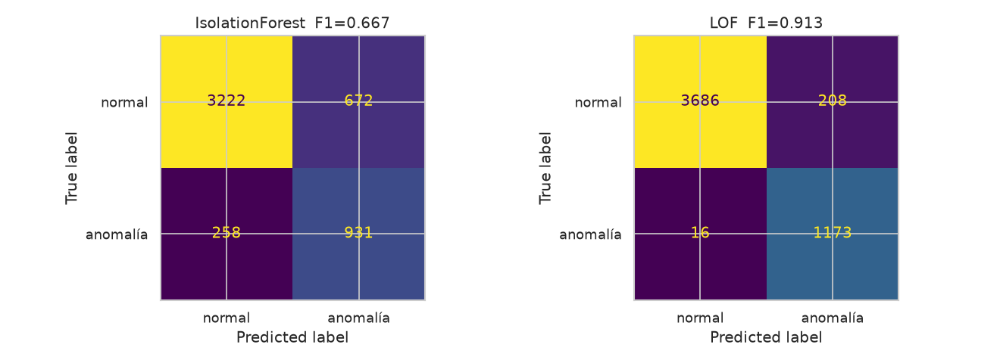

# Modelo ML de anomalías (Integrante 2)

Detecta lecturas anómalas de la incubadora (sensores + actuadores) y publica la alerta por MQTT.

## Flujo
`sensores/lectura` + `actuadores/estado` → features → `StandardScaler` → **LOF** → `ml/anomalia` → backend (Mongo `ml_anomalias` + `alarmas/critica`) → Grafana y página p5.js.

## Archivos
| Archivo | Qué es |
|---|---|
| `anomalias.ipynb` | Notebook documentado y ejecutado: exploración, limpieza, entrenamiento, evaluación y guardado |
| `construir_notebook.py` | Regenera y ejecuta el notebook |
| `pipeline.py` | Features, limpieza y anomalías simuladas (lo usan el notebook y el servicio) |
| `data/lecturas_fase2.csv` | Histórico de la Fase 2 exportado de MongoDB (27 537 lecturas, 2/sep – 2/oct) |
| `modelo/modelo_lof.joblib`, `modelo/meta.json` | Modelo entrenado, umbral y métricas |
| `service.py` + `Dockerfile` | Servicio MQTT (servicio `ml` del compose) |
| `simular_anomalia.py` | Publica lecturas normales y luego una falla, para la demo y las evidencias |
| `evidencias/` | Matriz de confusión, distribución del puntaje y log de una alerta simulada |

## Dataset y exploración
- Sin nulos ni duplicados; 1 lectura/s, con huecos entre sesiones de prueba.
- Dos regímenes normales: **incubación** (36.5–38.5 °C) y **precalentamiento** (20–35 °C con el foco encendido y la temperatura subiendo). Por eso no basta un umbral fijo: 30 °C es normal con el foco calentando y anómalo con el foco apagado.
- `alarma = 1` del firmware y lecturas imposibles (< 5 °C o < 5 % de humedad, fallas del DHT) se usan como **anomalías reales**.

## Preprocesamiento
- Features: `temperatura`, `humedad`, `calefaccion`, `ventilacion`, `rotacion`, `d_temp`, `d_hum` (derivadas por segundo; se reinician si pasan más de 10 s entre lecturas).
- Escalado con `StandardScaler`: LOF mide distancias y sin escalar la humedad dominaría a los actuadores.
- Entrenamiento **no supervisado**, solo con lecturas normales (70 %). Validación (15 %) y prueba (15 %) mezclan lecturas normales con anomalías reales del histórico y con anomalías **simuladas** sobre lecturas reales: sobrecalentamiento (foco pegado), enfriamiento (foco quemado), humedad baja o alta, saltos bruscos y actuadores incoherentes.

## Algoritmo y métricas (conjunto de prueba: 5 083 lecturas, 1 189 anómalas)
| Modelo | Precisión | Recall | **F1** | AUC-ROC |
|---|---|---|---|---|
| Isolation Forest | 0.581 | 0.783 | 0.667 | 0.874 |
| **LOF (n_neighbors=35)** | **0.849** | **0.987** | **0.913** | **0.980** |

Matriz de confusión del LOF (filas = real, columnas = predicho):

|  | normal | anomalía |
|---|---|---|
| **normal** | 3 686 | 208 |
| **anomalía** | 16 | 1 173 |



**Por qué LOF:** detecta el 99.5 % de las anomalías reales del histórico y el 100 % de los sobrecalentamientos, enfriamientos y actuadores incoherentes. Isolation Forest falla justo en las fallas que combinan variables (por ejemplo, temperatura baja con el foco apagado), porque corta el espacio con planos paralelos a los ejes. LOF compara cada lectura con la densidad de sus vecinos en el espacio conjunto.

## Umbral
- Puntaje LOF ≥ **1.63** (el que maximiza el F1 en validación; `ML_UMBRAL` lo cambia sin reentrenar).
- Para no alarmar por una sola lectura ruidosa, el servicio exige **3 lecturas atípicas seguidas** (`ML_CONSECUTIVAS`). Publica cuando cambia el estado o cada 5 s (`ML_PUBLICAR_CADA`).
- En 90 s de operación normal simulada no hubo ningún falso positivo.

## Contrato MQTT
Se suscribe a `smartegg/{id}/sensores/lectura` y `smartegg/{id}/actuadores/estado`. Ignora los mensajes retenidos, porque son snapshots viejos. Publica en `smartegg/{id}/ml/anomalia`:

```json
{"anomalia": true, "puntaje": 6.4622, "umbral": 1.6314, "lecturas_atipicas_seguidas": 3,
 "variable_principal": "temperatura", "desviacion_z": 1.11, "modelo": "LOF",
 "lectura": {"temperatura": 38.54, "humedad": 57.0, "calefaccion": 1.0, "ventilacion": 0.0, "rotacion": 0.0, "d_temp": 0.35, "d_hum": 0.0},
 "timestamp": "2026-10-21T03:56:30+00:00"}
```
`variable_principal` es la feature más alejada de lo normal, para que el operador sepa qué revisar.

## Ejecutar
```bash
# Con el stack (servicio "ml" en infra/docker-compose.yml)
docker compose -f infra/docker-compose.yml up -d --build ml

# Local
python -m venv .venv && .venv/bin/pip install -r requirements-notebook.txt
MQTT_HOST=localhost MQTT_PORT=1883 MQTT_USER=smartegg MQTT_PASS=... .venv/bin/python service.py

# Reentrenar y regenerar el notebook
.venv/bin/python construir_notebook.py
```

## Evidencia: alerta ante una anomalía simulada
```bash
MQTT_USER=smartegg MQTT_PASS=... python simular_anomalia.py --host IP --falla sobrecalentamiento
```
Publica 10 lecturas normales y luego el foco "pegado". A la tercera lectura atípica el servicio publica `anomalia: true`, el backend genera `alarmas/critica` tipo `anomalia_ml`, Grafana dispara la alerta "Anomalía detectada por el modelo ML" y la página muestra "Modelo ML: anomalía". El log completo está en `evidencias/alerta_simulada.log`.
