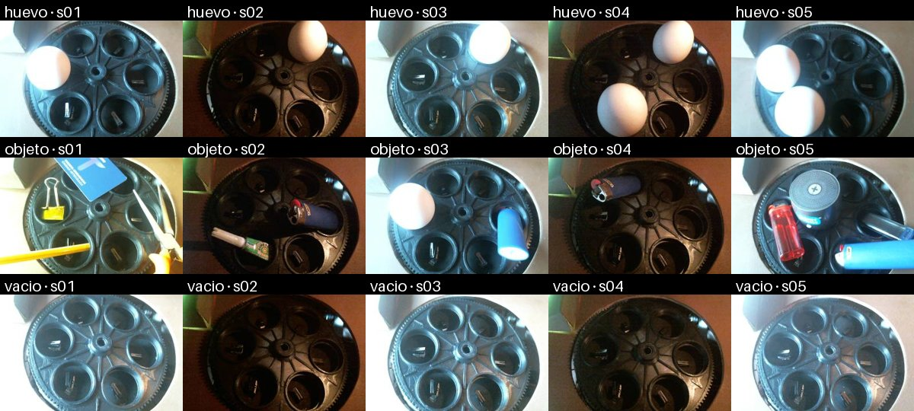
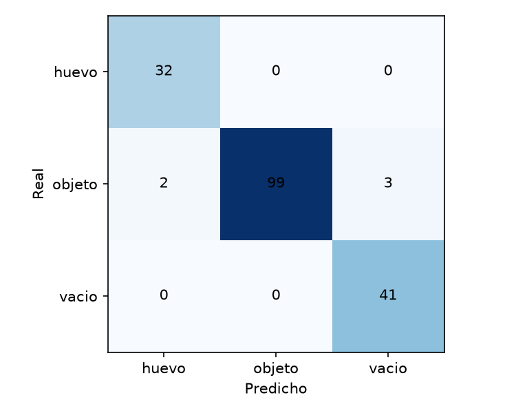
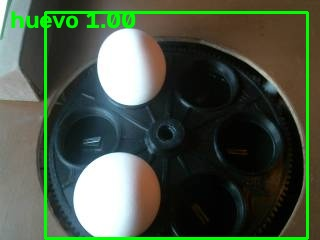
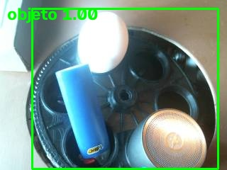
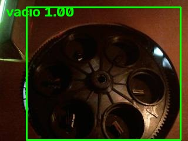

# Módulo de visión IA (Integrante 3)

Clasifica cada fotograma de la cámara en **huevo / objeto / vacio** para bloquear el sistema si hay un objeto extraño.

## Flujo
`camara/frame` (JPEG) → OpenCV (decodificar, recortar ROI, redimensionar 224×224, normalizar) → MobileNetV3-small (ONNX) → `vision/resultado`.

## Contrato MQTT
- Suscribe: `smartegg/{id}/camara/frame` — payload: bytes JPEG crudos.
- Publica: `smartegg/{id}/vision/resultado` — JSON:
```json
{"clase":"objeto_extrano","confianza":0.97,"probabilidades":{"huevo":0.02,"objeto_extrano":0.97,"vacio":0.01},
 "umbral":0.5,"objeto_detectado":true,"latencia_ms":18.4,"ts":"2026-10-21T15:00:00+00:00"}
```
`objeto_detectado` = clase objeto_extrano con confianza ≥ umbral (`threshold` de `models/config.json`, 0.5). El bloqueo lo decide el backend: 3 fotogramas seguidos de `objeto_extrano` con confianza ≥ 0.80 (`VISION_CONSECUTIVE_FRAMES`, `VISION_CONFIDENCE_THRESHOLD`).

## Condiciones detectadas
| Clase | Qué es |
|---|---|
| huevo | Uno o más huevos en la incubadora |
| objeto | Cualquier cosa que no sea huevo (provoca bloqueo) |
| vacio | Cámara sin nada |

## Dataset
Fotos reales tomadas el 22/10/2026 con la cámara instalada, `dataset/{clase}/{clase}_{sesion}_{n}.jpg`.

| Clase | s01 | s02 | s03 | s04 | s05 | Total |
|---|---:|---:|---:|---:|---:|---:|
| huevo | 262 | 63 | 65 | 32 | 59 | 481 |
| objeto | 212 | 107 | 100 | 104 | 116 | 639 |
| vacio | 196 | 155 | 40 | 41 | 40 | 472 |

Iluminación por sesión: s01 y s03 luz blanca intensa, s02 y s04 penumbra con luz cálida, s05 luz mixta. Objetos: encendedores, linterna, tarjeta, clip, lápiz, pinzas y cinta, solos o junto a huevos (huevo + objeto se etiqueta `objeto`).



## Entrenamiento y resultados
`python train.py --roi x,y,w,h` → `models/modelo.onnx`, `config.json`, `metrics.json`, `matriz_confusion.png`.
MobileNetV3-small preentrenada (ImageNet), 3 épocas con el extractor congelado y ajuste fino hasta 15; train/val/test separados **por sesión**.

Prueba (177 fotos): **exactitud 97.2 %**.

| Clase | Precisión | Recall | F1 |
|---|---:|---:|---:|
| huevo | 0.941 | 1.000 | 0.970 |
| objeto | 1.000 | 0.952 | 0.975 |
| vacio | 0.932 | 1.000 | 0.965 |

Matriz de confusión (filas = real): huevo `[32, 0, 0]`, objeto `[2, 99, 3]`, vacio `[0, 0, 41]`.



Umbrales evaluados (`metrics.json`): de 0.50 a 0.95 ninguno produce falsos bloqueos; el recall de objeto baja de 0.952 a 0.846. Umbral elegido: 0.5 en el servicio y 0.80 en la política de bloqueo del backend.

## Ejecución
```bash
pip install -r requirements.txt
MQTT_HOST=... MQTT_USER=... MQTT_PASS=... python service.py
```
Variables: `MQTT_HOST, MQTT_PORT, MQTT_USER, MQTT_PASS, DEVICE_ID (def. +), UMBRAL, EVIDENCE_DIR, EVIDENCE_EVERY`.

## Ejemplos procesados
El servicio guarda cada 15 s por clase el fotograma y la ROI en `evidencias/` (`fecha_hora_clase_confianza_{frame|roi}.jpg`).

| Clase | Fotograma | ROI |
|---|---|---|
| huevo |  |  |
| objeto |  |  |
| vacio |  |  |
